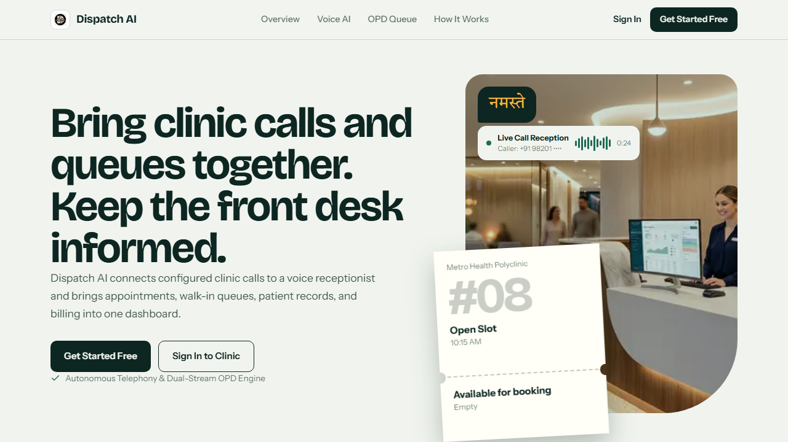
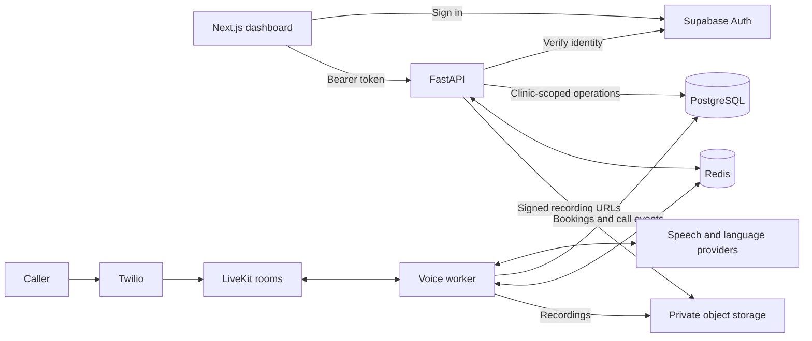

# Dispatch AI

Clinic operations software with appointment scheduling, patient queues, billing, and an AI voice receptionist. Dispatch AI brings telephone bookings and staff-managed visits into a shared workflow, from intake and check-in through consultation and payment.

Built with Next.js, FastAPI, PostgreSQL, and LiveKit Agents.



## Capabilities

| Area | Functionality |
| --- | --- |
| Appointments | Scheduled bookings, walk-ins, rescheduling, cancellations, and capacity checks |
| Front desk | Patient check-in, visit queues, consultation status, and end-of-day rollover |
| Patient records | Patient profiles, visit history, and clinician notes with role-based access |
| Billing | Partial payments, outstanding balances, payment receipts, and revenue reporting |
| Voice reception | Telephone intake, booking confirmation, call transcripts, and private recording playback |
| Clinic administration | Doctor schedules, special hours, staff permissions, and voice usage settings |

## Architecture

The application consists of a Next.js dashboard, a FastAPI backend, and a separate LiveKit voice worker. Supabase provides authentication, PostgreSQL, and private object storage. Redis supports caching and voice coordination.



### Implementation decisions

- **Booking consistency.** PostgreSQL transaction locks and database constraints coordinate concurrent booking requests and enforce appointment capacity.
- **Tenant access.** The API checks clinic membership and role permissions independently of the clinic selected in the browser. The database schema also defines row-level security policies.
- **Payment retries.** Settlement uses row locks and idempotency keys to handle repeated requests without duplicating payments.
- **Voice booking consent.** Conversation tools validate booking actions on the server and track caller confirmation before committing a voice booking.
- **Independent voice processing.** A dedicated worker handles conversations outside the HTTP request lifecycle, with admission controls, provider budgets, call duration limits, and retention settings.
- **Private recordings.** Call audio is stored in a private bucket and exposed through signed URLs.

### Technology

| Layer | Stack |
| --- | --- |
| Frontend | Next.js 15, React 19, TypeScript, Tailwind CSS |
| Client state | TanStack Query, Zustand |
| Backend | FastAPI, Pydantic, SQLAlchemy, asyncpg |
| Data and identity | PostgreSQL, Supabase Auth, Supabase Storage, Redis |
| Voice | LiveKit Agents, Twilio, Deepgram, Gemini/Groq, ElevenLabs |
| Testing | pytest, PostgreSQL integration tests, Playwright |
| Deployment | Docker Compose, Vercel, Render |

## Repository structure

```text
apps/
  api/
    app/
      agent/           LiveKit worker, prompts, and conversation tools
      api/v1/          REST, WebSocket, and telephony endpoints
      core/            Configuration, authentication, and infrastructure setup
      models/          SQLAlchemy models
      schemas/         Request and response contracts
      services/        Clinic, booking, billing, patient, and voice logic
    database/          Consolidated schema and historical migrations
    scripts/           Storage setup, voice diagnostics, and demo data utilities
    tests/             Unit and integration tests
  web/
    src/app/           Authentication, landing page, and clinic dashboard
    src/components/    Shared UI and context providers
    src/lib/           API transport and Supabase clients
    e2e/               Playwright tests and fixtures
assets/screenshots/    Application previews
.github/               CI workflows and contribution guidelines
docker-compose.yml     Local application services
render.yaml            API and voice worker deployment configuration
```

## Local development

### Prerequisites

- Node.js 22 and Python 3.11 or 3.12
- A dedicated development Supabase project
- Docker for the Compose stack, or a local Redis instance for manual setup
- Provider credentials for voice features, if enabled

### Configure the application

1. Copy `.env.example` to `.env` at the repository root and supply your development configuration.
2. In an **empty Supabase project**, apply [`apps/api/database/schemas/schema.sql`](apps/api/database/schemas/schema.sql) through the SQL editor. **The baseline drops existing application tables.** It includes the current schema; do not replay historical migrations after applying it. See the [database guide](apps/api/database/TABLES.md).
3. Enable Supabase email/password authentication and allow `http://localhost:3000/auth/callback` as a redirect URL. Create clinic accounts through the application signup flow.
4. For dashboard-only development, set `VOICE_ENABLED=false`. Configure the provider variables in `.env.example` when enabling voice.

| Variable | Purpose |
| --- | --- |
| `NEXT_PUBLIC_SUPABASE_URL` | Supabase project URL for the browser |
| `NEXT_PUBLIC_SUPABASE_ANON_KEY` | Supabase public key; a publishable-key alternative is also supported |
| `NEXT_PUBLIC_API_BASE_URL` | API URL accessible from the browser |
| `SUPABASE_URL`, `SUPABASE_SERVICE_ROLE_KEY` | Server-side Supabase access |
| `DATABASE_URL` | PostgreSQL connection string using `postgresql+asyncpg://` |
| `ADMIN_SECRET_KEY` | Random server-side administrative secret |
| `ALLOWED_ORIGINS` | Comma-separated frontend origins |
| `REDIS_URL` | Redis connection string; supplied automatically by Compose |

Keep `.env` files private. Only browser-safe values belong in `NEXT_PUBLIC_*` variables.

### Run with Docker

From the repository root:

```sh
docker compose up --build
```

| Service | Address |
| --- | --- |
| Dashboard | http://localhost:3000 |
| API documentation | http://localhost:8000/docs |
| Process health | http://localhost:8000/health |

Compose starts Redis, the API, and the dashboard. Supabase remains an external dependency. Use a database hostname reachable from the containers; `localhost` inside a container refers to that container.

To include the configured voice worker:

```sh
docker compose --profile voice up --build
```

To stop the stack:

```sh
docker compose down
```

### Run services individually

Create and activate a virtual environment, then install dependencies from the repository root:

```sh
python -m venv .venv
```

Activate with `.venv\Scripts\Activate.ps1` in PowerShell or `source .venv/bin/activate` on macOS/Linux.

```sh
python -m pip install -r apps/api/requirements-dev.txt
npm --prefix apps/web ci
```

Copy the root `.env` to `apps/api/.env`. Create `apps/web/.env.local` with the three `NEXT_PUBLIC_*` variables from the table above. Start Redis and set `REDIS_URL` in the API environment.

Start the API from `apps/api`:

```sh
python -m uvicorn app.main:app --reload
```

In a separate terminal, start the dashboard from the repository root:

```sh
npm run dev:web
```

## Testing

With the virtual environment active and dependencies installed, run from the repository root:

```sh
python -m pytest
npm run lint
npm run typecheck
npm run build:smoke
npx --prefix apps/web playwright install chromium
npm run test:smoke
```

The default backend suite uses isolated configuration and excludes tests marked `live` or `voice_db`. Browser smoke tests run against a production web build with placeholder public configuration and require no staging accounts or paid providers.

PostgreSQL integration tests cover database behavior such as concurrent reservations and idempotent settlement. Authenticated browser tests exercise clinic workflows against a dedicated staging environment. Setup and commands for both are in the [testing guide](apps/web/e2e/README.md).

CI runs frontend linting and type checks, a smoke build and browser tests, backend unit tests, disposable PostgreSQL tests, dependency audits, and a source credential scan. To run dependency audits locally:

```sh
npm --prefix apps/web audit
python -m pip_audit
```

## Deployment

- **Dashboard:** configure Vercel with `apps/web` as the project root and supply the public web environment variables.
- **API and voice worker:** use [`render.yaml`](render.yaml) to configure the two services. Supply credentials separately for each service and configure Redis.
- **Authentication:** register the deployed frontend callback URL in Supabase and restrict API CORS origins to the intended frontend domains.
- **Voice:** configure LiveKit and Twilio SIP routing, an externally reachable webhook, and the required speech and language providers.

Set `ENVIRONMENT=production` on the API and worker. Public frontend variables are compiled into the web build; changing them requires a rebuild.

### Operational utilities

| Script in `apps/api/scripts/` | Purpose |
| --- | --- |
| `ensure_voice_storage.py` | Check or create the private recording bucket |
| `voice_preflight.py` | Inspect voice configuration and database readiness |
| `voice_credits.py` | Inspect balances and grant voice minutes |
| `seed_clinic_demo.py` | Populate a disposable clinic with fictional activity |

The demo seeder replaces records for the selected clinic and requires explicit clinic confirmation in a non-production environment. Review each utility's configuration before running it.

## Operational scope

Use synthetic patient data for development and evaluation. The application has not been validated for clinical decision making or handling real patient data. Live voice behavior requires separate verification with configured provider accounts; isolated tests do not establish carrier or provider reliability. The `/health` endpoint reports process availability rather than dependency readiness.

## Contributing and security

See the [contribution guide](.github/CONTRIBUTING.md) for development guidelines and the [security policy](.github/SECURITY.md) for reporting vulnerabilities privately.

## License

[MIT](LICENSE). Third-party dependencies, media assets, and provider services are subject to their respective terms.
