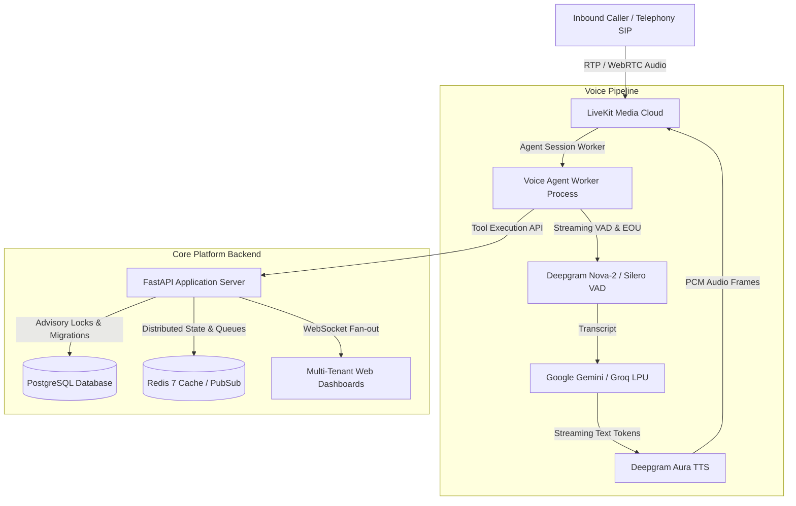

# Dispatch AI — System Architecture & Concurrency Model

## 1. Concurrency & Locking Architecture

- **Single-Winner Capacity Windows**: Concurrent appointment requests for identical doctor slots serialize via PostgreSQL transactions. If capacity window quota is exhausted, competing requests fail fast with `HTTP 409 Conflict ("fully booked")`.
- **Active Visit Idempotency**: Patient queues enforce zero-duplicate booking invariants. If an active visit exists for a phone number or patient ID on the current clinic day, subsequent booking attempts are deflected to avoid double charges and duplicate chamber tokens.
- **Worker Crash Recovery**: Multi-worker reconciliation leases (`claim_reconciliation_batch`) periodically sweep for expired worker leases, ensuring that crashed or severed voice worker processes do not leak SIP legs or leave appointments in indeterminate states.

## 2. Real-Time Telemetry & WebSocket Synchronization

- **Queue Fan-Out**: The `DispatchWebSocketManager` maintains tenant-isolated connections. When an encounter transitions (`arrived -> called -> in_consultation -> completed`), the event is dispatched across all connected clinical staff interfaces within < 5 ms.
- **Latching Emergency SOS**: Acute triage deflection broadcasts `EMERGENCY_SOS_ALERT` across Redis PubSub and latches the state so late-connecting staff interfaces receive immediate notifications.
